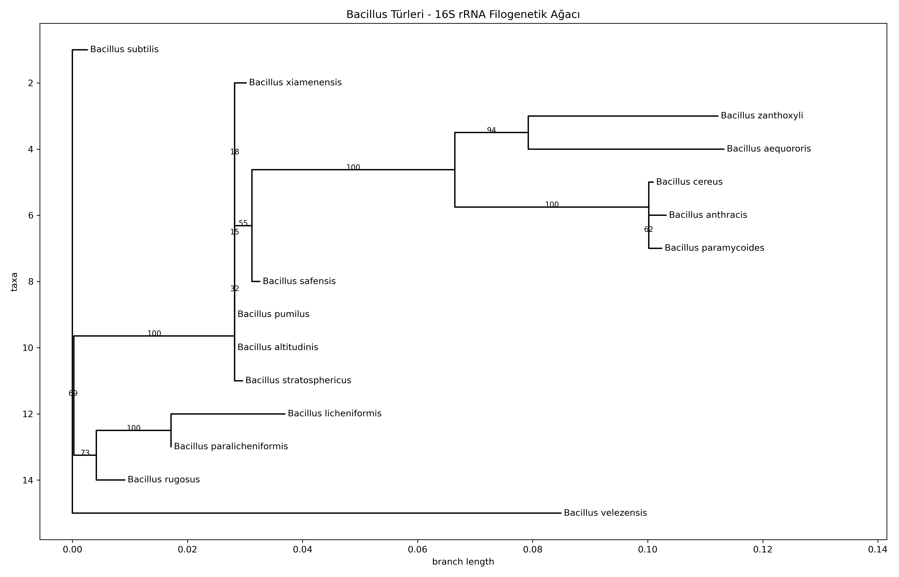

# 16S rRNA-Based Phylogenetic Analysis of *Bacillus* Species

 

## Objective

This project reconstructs the evolutionary relationships among 15 *Bacillus* species from publicly available 16S rRNA sequences (NCBI). It is a learning/portfolio project that implements a complete phylogenetics workflow end to end: data retrieval → multiple sequence alignment → tree inference → visualisation.

## Result



The tree is consistent with known taxonomic groupings:

- ***B. cereus* group:** *B. cereus*, *B. anthracis* and *B. paramycoides* cluster together (bootstrap 100 / 62)
- ***B. licheniformis* / *B. paralicheniformis*:** grouped with 100% bootstrap support
- ***B. pumilus* group:** *B. pumilus*, *B. altitudinis* and *B. stratosphericus* fall in the same clade

## Data

- **Source:** NCBI Nucleotide, downloaded automatically through the Entrez API with Biopython
- **Query:** `Bacillus[Organism] AND 16S ribosomal RNA[Title] AND 1200:1600[Sequence Length]`
- 15 species, one sequence per species

## Methods

| Step | Tool |
|---|---|
| Data retrieval | Biopython (Entrez) → FASTA |
| Multiple sequence alignment | MAFFT (`--auto`) |
| Tree inference | IQ-TREE (ModelFinder Plus model selection, 1000 ultrafast bootstraps) |
| Visualisation | Biopython Phylo + Matplotlib |

## How to Run

```bash
conda create -n biyoinfo python=3.10 -y
conda activate biyoinfo
conda install -c bioconda -c conda-forge blast mafft iqtree biopython matplotlib -y

cd scripts
python download_data.py
mafft --auto ../data/bacillus_16s_raw.fasta > ../data/bacillus_16s_aligned.fasta
iqtree -s ../data/bacillus_16s_aligned.fasta -m MFP -bb 1000 -nt AUTO -pre ../results/bacillus_tree
python plot_tree.py
```

## Repository Structure

```
bacillus-16s-filogenetik/
├── data/        # raw and aligned 16S FASTA files
├── scripts/     # download_data.py, plot_tree.py
├── results/     # IQ-TREE outputs (.treefile, .contree, .iqtree, .log …)
├── figures/     # tree images
└── environment_list.txt
```

## Limitations

- Only a single locus (16S rRNA) is used; it has limited resolution for closely related species.
- Some branches have low bootstrap support (15–32%), so those splits are not statistically reliable.
- Small sample (15 species, one sequence each): results are not a taxonomic revision. This is a learning/portfolio project.

## Author

**Atakan Aslan** · Molecular Biology and Genetics, Sivas Cumhuriyet University
